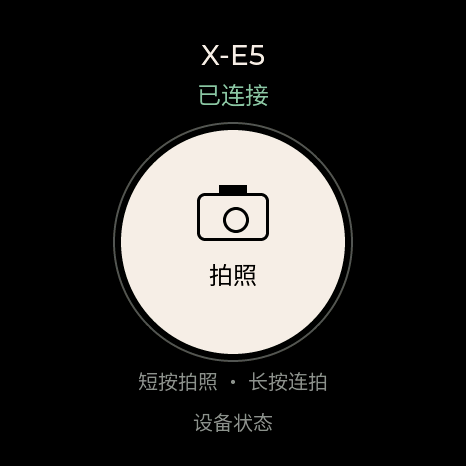
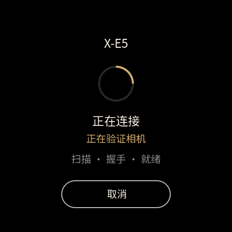
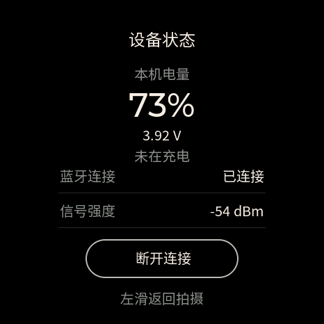
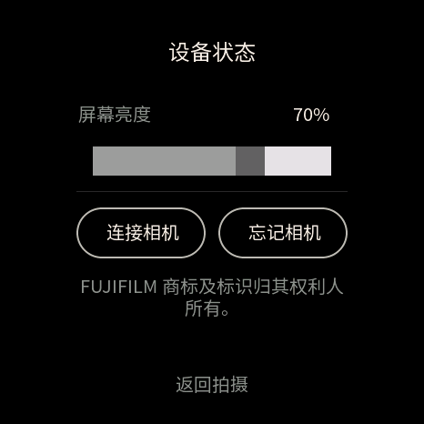

# camera-rc · X-E5 圆屏遥控器

基于 ESP-IDF 的富士相机蓝牙遥控器，适用于 **Waveshare ESP32-S3-Touch-AMOLED-1.43C**。支持单相机配对、开机自动连接、触摸或 BOOT 快门，以及圆屏设备状态显示。

项目已实现富士 Basic／Secure 连接与拍照协议，并在本项目 X-E5 上验证了开发板重启后复用绑定自动连接。

参考项目：[furble](https://github.com/gkoh/furble/tree/0cac22aacc3d9ef250be40849118af78a5f39f27)（富士连接与拍摄协议）、[Waveshare 1.43C](https://github.com/waveshareteam/ESP32-S3-Touch-AMOLED-1.43C/tree/8cea11ddae6167dd591d1f5465fd7b615080360f)（板卡配置与示例）。

## 界面

以下为生产 UI 的 466×466 LVGL 软件渲染，连接和电量数据为模拟值。

| 拍摄 | 连接中 |
| :---: | :---: |
|  |  |
| 设备状态 | 设备管理 |
|  |  |

## 快速开始

在 **IDF_v5.5.3** 环境中进入项目根目录，执行以下命令：

```powershell
cd C:\path\to\camera-rc-1.43c  # 替换为实际项目路径
.\project.ps1 setup
.\project.ps1 doctor
.\project.ps1 test
.\project.ps1 build
.\project.ps1 flash --port COM5  # 替换为实际串口
.\project.ps1 monitor --port COM5
```

macOS 和 Linux 下使用 [project.sh](https://github.com/copfee/camera-rc-1.43c/blob/main/project.sh)，例如 `./project.sh build`。

需要 Git、Python 3.10–3.13、CMake 和 C++17 编译器。`setup` 可在工程内安装 SDK 和工具链；已有 SDK 时可通过 `IDF_PATH` 指定。普通刷写保留 NVS 和配对记录；完整擦除会删除配对记录，需显式使用 `erase --confirm-erase`。

## 使用

1. 在相机开启蓝牙配对，遥控器扫描并选择相机。Secure 配对时核对双方显示的六位数字并确认。
2. 连接就绪后，短按快门请求对焦并拍照；长按保持快门，松开停止。连拍模式和速度由相机设置。
3. 点击拍摄页顶部标识进入设备状态，查看连接和本机电量，或管理相机。设备只保存一台相机；更换时先选择“忘记相机”。

有保存记录时开机自动连接；意外断线会有限重试，主动断开后可手动连接。首次触摸熄灭的屏幕只唤醒屏幕，BOOT 键直接响应拍照。本地快门声音和“指令已发送”不代表相机已完成拍摄。

## 验证与资料

截至 2026-10-29，主机回归及 ESP-IDF v5.5.3 构建已通过；X-E5 重启重连已实机验证。新版人工配对交互、不同对焦模式、长按连拍及长期稳定性仍需进一步验收。详细结果见[验证记录](docs/verification.md)和[实机验收清单](docs/acceptance.md)。

- [硬件与故障排查](docs/hardware.md) · [协议说明](docs/protocol.md) · [架构与扩展](docs/architecture.md)
- [界面设计与截图生成](docs/design/README.md) · [重连调查](docs/reconnect-investigation.md)

项目不包含图传、GPS、OTA、照片传输或多相机同时控制。
